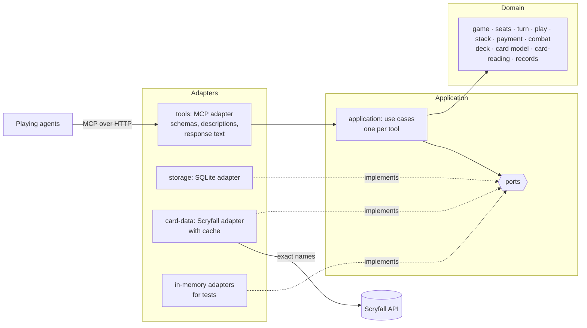

# High-Level Design: MTG Goldfishing

## Problem

A deck-building workflow has an AI agent write a Commander deck list and then play test games to find the deck's strengths and weaknesses. When those games are played entirely in the agent's head, four things go wrong:

- **Randomness is fake.** The agent effectively chooses its own draws, so opening hands, land drops and color problems reflect what the agent expects rather than a real shuffle.
- **State drifts.** Over a long game the agent loses track of tapped lands, hand size, commander tax, land drops and triggers. The errors compound silently, and they tend to compound in the deck's favor.
- **Results are unstructured.** Games cannot be reproduced, and findings live in prose rather than in data an analysis step can rely on.
- **There is no opposition.** A game against opponents who take no actions measures a deck's mana and speed, but not how it fares against blockers, removal, counterspells and board wipes, which are what swing real games. An agent asked to imagine that opposition decides it itself, in its own deck's favor.

A full rules engine with a built-in opponent would fix all four, but every card's behavior would have to be encoded and an opponent policy written, which is a multi-year undertaking. Most of the value comes from something much smaller.

## Approach

MTG Goldfishing is a service that **holds the game state, owns the randomness, does the bookkeeping that card data alone can support, and records everything**. Agents remain the players: they make every decision and tell the service what each card does.

### Two kinds of game

Every game judges one deck, the **tested seat**'s.

- A **goldfish game** plays the tested seat against three imaginary opponents who take no actions. It measures mana base and speed.
- A **contested game** plays the tested seat against one to three **opposing seats**, each backed by a loaded deck and played by an agent. It measures how the deck performs against real opposition. There are no imaginary opponents in a contested game: one opposing seat makes a duel, three a four-player game.

The opposing decks are the test's equipment; the record and the verdict are about the tested seat. Comparing decks is done outside the service, by running each as the tested seat and comparing the records.

Whoever starts a game decides which agent plays which seat: one agent may play every seat, or each seat may have its own agent. Each agent's aim comes from the brief its caller gives it.

### The agent describes outcomes; the service fills in bookkeeping

A play is one call stating where things end up ("Cultivate: this Plains to the battlefield tapped, this Forest to hand"). The service applies it, pays the cost, moves the spell to its default destination, shuffles if the library was searched, and answers in a few lines ending with a one-line status of the game.

### Each seat sees its own game

In a contested game each seat has its own seat id, and every view the service gives a seat (its responses and its state) shows only what that seat's player could see: its own hand and library, every public zone, and the sizes of the others' hidden zones. The service hides in its views; it does not police agents. An agent that holds several seat ids, or reads the game's log, sees more, and that is its caller's choice.

### The service keeps the stack's order, not its meaning

In a contested game a play or effect is held on a **stack** with the delta its controller stated, so that other seats can respond before it resolves. The service asks the other seats in turn order, at a few response windows, and applies the newest held delta once everyone has passed. It never works out what a card does: a counterspell is a delta that moves the countered card; a spell whose target vanished is restated by its controller.

### Checks are advisory, structure is not

The service distinguishes two kinds of refusal. An **error** is a structural impossibility (a card that is not in the named zone, a game that has ended, a seat acting out of turn) and can never be overridden. A **rule check** is an approximation drawn from card data (cost not payable, land drop already used) and can always be overridden by the agent with a stated reason, which is recorded.

### The service reads card text where reading it is cheap and checkable

The service does not know what cards do, with deliberate exceptions: it reads rules text to learn **how much mana of which colors a permanent makes**, which **step triggers** a permanent has, whether a permanent has or grants **haste or vigilance**, has **flash**, and whether a permanent **enters tapped**. These are narrow, pattern-shaped readings whose results are shown to the agent, and they are what make automatic payment and trigger reminders possible.

### Everything is recorded

Every tool call is stored with its arguments, status and response, and the seat that made it, including refused ones (a log export is recorded by its size). Every accepted change is logged with the acting seat's choices and reasons, and each turn ends with a snapshot. Analysis happens outside the service, from these records.

### A domain model at the center

The game of Magic as this service sees it — games, seats, card instances, zones, mana, costs, payments, steps, the stack, readings, deltas — is modelled directly in code, in the project's own vocabulary, with no knowledge of databases, networks or MCP. Everything else is arranged around that model as ports and adapters. The model is shaped to stay readable, maintainable and extensible over the long term, for human and agent maintainers alike.

## Target Users

- **A playing agent**: an AI agent, usually a subagent, playing one seat of a game through the tools, or every seat of one. It needs short calls, short answers that always say where the game stands and what other seats just did, and refusals that explain themselves. It pays for every token in tool descriptions, calls and responses.
- **An orchestrating agent or person** running a deck-improvement workflow: loads decks once, starts many games on them (often several at once), chooses the opposing decks and who plays each seat, then collects the logs.
- **An analysis process** that reads logs and snapshots as data and produces findings about the deck.
- **A maintainer**, human or agent, changing the service later. They need code that reads in the vocabulary of the game, rules that can be found in one place, and tests that say what behavior they protect.

## Goals

1. **Agents make every decision a player would**: mulligans, land drops, what to cast and from where, every choice a card requires (X, modes, targets), attacks, blocks, responses, and how each card resolves.
2. **Realistic opposition.** A deck can be tested against one to three opposing decks that block, remove, counter and wipe, each seat played by an agent that sees only what its player could see.
3. **The service owns state and randomness.** Shuffles and turn order are seeded, so the same loaded decks and seed reproduce the same game, and a seat's draws for a seed do not depend on which other decks are at the table. Library order is never visible to any agent.
4. **The service does data-driven bookkeeping and checks**: mana payment (including X, additional costs and commander tax), zone integrity, land drops, hand size, the full turn structure, life totals, commander damage and elimination.
5. **Automatic payment preserves the agent's options.** When the agent does not say how to pay, the auto payment system pays in the way that leaves the most other plays available.
6. **Short exchanges.** A typical play is one short call with a two-to-four-line response. In a contested game each response opens with a short digest of what the other seats did since the seat's last call. Full state is sent only on request.
7. **Concurrency.** Many agents run independent games at once without affecting each other, and the seats of one game can be played by separate agents at once.
8. **Drift detection.** Optional `expect` assertions and step trigger reminders catch the agent's picture of the game diverging from the real state.
9. **Complete records.** Logs, turn snapshots and call records give an outside process everything it needs, and survive a restart of the service.
10. **Usable on day one.** The service's own instructions and tool descriptions are enough for an agent to play a seat of a game, and a player brief makes it usable as a Claude Code subagent.
11. **Code that reads as the domain.** A rule of the game as the service sees it is written once, in the domain model, in glossary terms, and can be tested without a database, a network or an MCP client.

## Non-Goals

- **Implementing Magic's rules.** The service does not resolve abilities, apply replacement effects, track layers, work out combat between creatures, or validate targets and modes. It keeps the order of the stack, but what each item does is stated by its controller.
- **Exact timing and priority.** Response windows open only at a few points of a turn, and a seat with no untapped permanents is passed automatically, even though Magic's rules give priority more often and a free spell could be cast.
- **Playing the game.** No built-in AI, heuristic policy or autopilot, for any seat. The auto payment system chooses how to pay, never what to play.
- **Acting imaginary opponents.** The imaginary opponents of a goldfish game take no actions; opposition comes only from opposing seats with decks. The agent may model an imaginary opponent's action itself as an effect.
- **Policing agents.** The service keeps hidden information out of each seat's views, but does not stop an agent from reading the log or playing several seats.
- **Event-based triggers.** "Whenever a creature enters" and similar triggers are their controller's responsibility. Only step triggers get reminders.
- **Deck management.** No deck versions, deck history, or relationships between decks. A loaded deck is identified only by its contents.
- **Statistics and analysis.** The service stores and returns records. Metrics, comparisons between decks and findings are produced elsewhere.
- **The deck-improvement workflow.** Building decks, choosing opposing decks, analysing logs and editing decks happen outside the service.
- **Tuning the tool surface by measurement.** A loop that replays benchmark games to refine tool names, descriptions and response formats is a separate project; the call record exists so that project has data.
- **Ending games.** The service notifies when an end condition is met and applies eliminations; only the tested seat's agent ends a game.
- **Accounts, authentication and billing.** The service has no notion of who is calling.

## Tenets

Ordered: when two conflict, the higher one wins.

- **It's the agent's simulation.** When the service is unsure whether something is allowed, it lets the agent proceed with an override and records it, rather than blocking; it hides what a seat may not see, but does not police what an agent chooses to look at.
- **Pushback over fidelity.** When an exact model of Magic's timing or hidden information would cost far more than an approximation that still lets the opposition push back, take the approximation.
- **Best guess, shown.** When the service must read a card or choose on the agent's behalf, it acts on its best reading and says what it assumed; it holds back only when it has no usable reading at all.
- **Clear before cheap.** When a response or tool description could be shorter or clearer but not both, it is clearer.
- **The domain stays pure.** When a rule could live in the domain model or be handled more conveniently at the edge — in a tool handler, a query, a formatter — it lives in the domain model.
- **Build for local, don't block hosted.** Nothing is built for a multi-user hosted service until it is needed, but no choice may make one impossible.

## System Design

One long-running Python process serves MCP over streamable HTTP, mounted in a FastAPI application bound to the local machine. Agents connect by URL. All state lives in one SQLite database in WAL mode.

### Architecture: ports and adapters

The code is arranged in three rings, and dependencies point only inward.

- **Domain.** The model of a game and everything that can be decided from it: the `Game` aggregate with its seats, card instances, zones and stack; the immutable `LoadedDeck`; value objects such as mana strings, costs, steps, deltas and readings; and domain services such as the auto payment system and the card reader. The domain performs no I/O, reads no clock, draws no randomness except through a seed it is given, and imports nothing from the other rings.
- **Application.** One use case per tool. A use case fetches what the domain needs through ports, asks the domain to decide, and saves the result. The application owns the ports: the interfaces through which it reaches persistence, card data, identifiers, time, and the announcement that a game has changed, which lets a waiting seat wake.
- **Adapters.** The MCP adapter drives the application: it turns tool calls into use-case requests and turns results into response text. The SQLite and Scryfall adapters are driven by it: they implement the ports. In-memory adapters implement the same ports for tests.

A use case returns a structured **outcome** — a status, a list of typed events (cost paid, cards drawn, reminder issued, notice raised), and the facts for the status line. Response text and log entries are both produced from that one outcome, so what the agent is told and what is recorded cannot disagree. A seat's digest is built from the same events, filtered by the domain to what that seat may see.

Domain operations never half-apply. An operation takes a game and returns either a changed game with its events or a refusal; a refused operation leaves the original untouched.

Every accepted change to a game increases that game's **change number**, which every response shows. A changing call may state the change number it follows; a call resent after a lost response is then recognised against the sending seat's most recent change and answered with the original response instead of being applied twice.

Calls for the same game are applied one at a time, whichever seat makes them; calls for different games do not wait on each other. A seat waiting for its turn to act holds no lock on its game.

### Seats inside one game

A game holds the table and its seats. The **table** is what all seats share: the seed, the change number, turn order, the active seat, the current step, the stack and any open response window, the status, notices and result. A **seat** is what one player has: its card instances and zones, life, mana pool, land drop, commander tax, mulligans, pending choices and reminders. Every card instance has an owner and a controller.

A goldfish game is a game with one seat, which additionally keeps the imaginary opponents' damage and commander damage. Every rule of play is written once, against the acting seat, and applies to both kinds of game. A change that touches several seats, such as removal aimed at another seat's creature, is one operation on one aggregate.

`new_game` returns an id for each seat. In a goldfish game the tested seat's id is the game id. Every game-scoped call is made with a seat id and acts as that seat.

### Components

Each is one leaf design under `docs/intent/`, owning the requirement prefix shown.

| Component | Ring | Prefix | Owns |
|---|---|---|---|
| `game` | Domain | `GAME` | `new_game`, `mulligan`, `get_state`, `end_game`: the game aggregate, its seats and seat ids, card instances, owners and controllers, zones, name resolution, seeded shuffling and turn order, the change number, what each seat may see, life totals, elimination, end-condition notices |
| `turn` | Domain | `TURN` | `advance`: the step sequence, turn rotation and rounds, automatic steps, trigger reminders for every seat, cleanup |
| `play` | Domain | `PLAY` | `play`, `effect`, `choose`: deltas, including deltas that reach other seats' cards; defaults; choices and pending choices addressed to a seat; errors and rule checks, overrides, `expect` |
| `stack` | Domain | `STACK` | The stack of held plays and effects, response windows, asking seats in turn order, automatic passes, resolution, and confirming or restating a held delta |
| `payment` | Domain | `PAY` | The mana pool, the auto payment system, agent-directed payment |
| `combat` | Domain | `CMBT` | `attack`: attackers and what each attacks, blocks, the attacking seat's statement of combat between creatures, combat damage to players, commander damage |
| `deck` | Domain | `DECK` | `load_deck`: list parsing, commander, card definitions, deck checks, the content-derived deck id |
| `card-reading` | Domain | `READ` | Reading rules text and keywords: mana sources and their amounts, step triggers, haste and vigilance, flash, entering tapped |
| `records` | Domain | `REC` | `get_log`: the shape and meaning of log entries, turn snapshots and call records, and the seat each belongs to |
| `application` | Application | `APP` | The use cases, the ports, outcomes, digests, `wait`, transactions, per-game ordering, and the rule that dependencies point inward |
| `card-data` | Domain + adapter | `CARD` | The card model (domain) and the Scryfall adapter with its cache that supplies it |
| `storage` | Adapter | `STOR` | The SQLite adapter behind the persistence ports |
| `tools` | Adapter | `TOOL` | The MCP adapter: tool definitions and descriptions, the response text format and statuses, the digest's wording, server instructions, the player brief, HTTP serving and configuration |

### Tools

`load_deck`, `new_game`, `mulligan`, `get_state`, `play`, `effect`, `attack`, `choose`, `advance`, `wait`, `end_game`, `get_log`. Every game-scoped tool takes a seat id first; in a goldfish game that is the game id. All respond in compact text except `get_log`, which returns JSON.

### Testing

The rings are tested at their own level, so each test says one thing and fails for one reason.

- **Domain tests** (pytest) exercise the model directly, with no adapters at all. Game states, including tables of several seats and a stack, are set up with test builders that read like the situation being tested.
- **Feature tests** (behave) express scenarios in the language of play and drive the service through its tools, with in-memory adapters behind the ports, so they run in milliseconds and never touch disk or network. Contested-game scenarios drive several seats through their own seat ids.
- **Contract tests** (pytest) state what each port promises and run against every adapter that implements it, in-memory and real alike, so the fakes used by other tests are known to behave like the real thing.
- **A small end-to-end check** starts the real process with SQLite and plays a short goldfish game over HTTP, and a short contested game with two seats played by separate clients.
- **An architecture test** fails the build if an inner ring imports an outer one.

Tests use recorded card data and never reach the network. Every requirement is cited by at least one test.

## Key Design Decisions

- **A state keeper, not a rules engine.** The agent describes what cards do; the service checks only what card data supports. *Alternative:* a rules engine that resolves cards itself — rejected because encoding every card is years of work and the problems above do not need it.
- **Opposition is seats with decks, played by agents.** *Alternative:* a built-in opponent policy — rejected because the service would then be playing the game, and writing a competent policy is as large as a rules engine. *Alternative:* a seeded pressure profile that has the imaginary opponents block, remove and wipe on a schedule — rejected because it is a script rather than a deck, and the service would be deciding what the opposition does.
- **Every game judges one deck.** *Alternative:* a symmetric head-to-head whose verdict is which deck is better — rejected because one game is weak evidence for that claim, and comparison already belongs to analysis outside the service.
- **No imaginary opponents in a contested game.** *Alternative:* imaginary opponents filling the seats without decks — rejected because they have no board to target, so every opposing removal spell and attack would go to the tested seat, a harsher test than any real game; a duel is a real format.
- **Seats inside one game aggregate.** *Alternative:* a separate contested-game aggregate beside the goldfish game — rejected because the turn, play, payment and combat rules would either fork and drift apart or be extracted into shared services, the same refactor plus a second aggregate to persist and test. *Alternative:* a table aggregate over one goldfish-style game per seat — rejected because turn, step and change number would live in two places, cross-seat changes would span several games, and a goldfish game would need a code path of its own.
- **The stack is its own component.** *Alternative:* the stack as part of `play` — rejected because response windows, turn-order asking and resolution are a mechanism of their own that is likely to grow, and keeping it apart keeps `play` about what a single call does.
- **Held plays carry their delta.** A spell with no responses still takes one call. *Alternative:* cast now, state the delta on resolution — rejected because every spell would take two calls. *Alternative:* resolve immediately and let others react afterwards — rejected because counterspells and responses would be impossible.
- **Hide in the views, don't police the agents.** Each seat's responses and state show only what that seat may see; the log stays open to everyone. *Alternative:* refuse `get_log` to seats while a game is running — rejected because an agent's conduct is its caller's choice, and one agent may legitimately play every seat.
- **One seed for the table, independent per seat.** *Alternative:* one shuffle stream shared by all seats — rejected because the tested seat's draws would then change with the opposing decks, and its goldfish and contested games on one seed could not be compared.
- **Current state is stored; the log is a record.** *Alternative:* store only seed, decks and accepted calls, and rebuild state by replay — rejected because every later change to a check or to the auto payment system could change what an old game replays to, and play is forward-only. *Alternative:* state in memory with periodic saves — rejected because a restart could lose plays.
- **One outcome, rendered twice.** A use case returns typed events; the response text and the log entry are both derived from them, and so is each seat's digest. *Alternative:* build the response string and the log entry separately — rejected because they drift apart.
- **A domain model behind ports and adapters.** *Alternative:* tool handlers that read and write the database directly — rejected because the rules would be spread across handlers and SQL, could only be tested through a running server, and would be rewritten when the transport or database changes. *Alternative:* layers without explicit ports — rejected because nothing would stop game logic reaching for the database, and tests would need the real one.
- **The service fetches card data from Scryfall itself, by exact name.** *Alternative:* have the agent look cards up and pass the data in — rejected because the data would cross the agent's context twice and any transcription error would silently corrupt every later payment check. *Alternative:* fetch through a card-lookup MCP server — rejected because the available one returns prose without faces, mana value or reliable name matching. The agent may still supply a **card definition** for any card in a deck, found or not, replacing the fetched data.
- **The service reads mana abilities from rules text.** Structured card data says which colors a card can make but not how much, and automatic payment needs both. *Alternative:* the agent declares every mana source — rejected as the largest source of bookkeeping the service exists to remove.
- **A resent call is harmless when the agent says what it follows.** *Alternative:* no protection — rejected because a call applied twice (a second draw, a second land) silently corrupts the game. *Alternative:* a client-chosen unique id per call — rejected because the change number is already on every response, costs nothing to produce, and also tells an agent when its picture of the game is stale.
- **The seed is visible to the playing agents.** Replaying decks and a seed is the purpose of a seed, and whoever starts the games chooses when to reuse one. A playing agent that has seen a seed's game before knows its draws, and the other seats' draws; the service does not try to prevent that.
- **Decks are loaded once and referred to by id.** `load_deck` takes the list as text and returns an id derived from its contents and card data; `new_game` takes that id, and one more for each opposing seat. *Alternative:* `new_game` takes a file path — rejected because server and agent may not share a disk. *Alternative:* `new_game` takes the list — rejected because a deck is normally played many times and the list would be resent each time.
- **Served over HTTP, not stdio.** One process serves every agent, which lets the seats of one game be played by separate agents, and is the shape a hosted service would take. *Alternative:* a stdio server launched per client — rejected because separate clients could not share a game, and it cannot be offered to others later.
- **No identity.** Game and seat ids are random and unguessable, which is the only access control. *Alternative:* users and sessions now — rejected under *Build for local, don't block hosted*.
- **The first turn draws a card by default.** Commander is a multiplayer game, where no player skips their first draw, and a goldfish game stands in for one. `new_game` can turn this off.

## Success Metrics

- The same loaded decks and seed produce the same opening hands, draws and turn order, every time, and the tested seat's opening hand and draws for a seed are the same in a goldfish game and in every contested game.
- An agent given only the server's instructions and tool descriptions completes a ten-turn goldfish game, or plays its seat through ten rounds of a contested game, without reading any other documentation.
- In routine play, fewer than one call in ten is refused, and `get_state` is needed less than once per turn.
- After a game, the service's final state matches what an independent replay of the log entries produces by hand: no card is lost or duplicated between zones or seats.
- Twenty games played at once produce twenty independent, complete logs, and a contested game whose four seats are played by four separate agents produces one complete log.
- The whole domain and feature test suites run without a database file, a network connection or a running server.
- A goldfish game's calls, responses, status line and records carry nothing of contested games: no seat ids beyond the game id, no digest, no stack and no response windows.

**Falsification signals:** an agent can learn the order of a library other than by replaying a seed it has already played; a seat's responses or state show another seat's hand or library; a refused call changes state; a game's state is lost or altered by restarting the service; the auto payment system taps sources in a way that makes a card in hand uncastable when another payment would not have; a goldfish game's response shows a digest, the stack or a response window; a domain module imports an adapter; a rule of play is implemented in a tool handler or a SQL statement.

## References

- Scryfall API: `https://scryfall.com/docs/api`
- Model Context Protocol Python SDK: `https://github.com/modelcontextprotocol/python-sdk`
- Magic Comprehensive Rules 103.8c (no player skips the first draw in multiplayer), 117 (timing and priority), 405 (stack), 506–511 (combat), 800 (multiplayer rules, including 800.4a on leaving the game), 903 (Commander)
- `GLOSSARY.md` for project vocabulary
