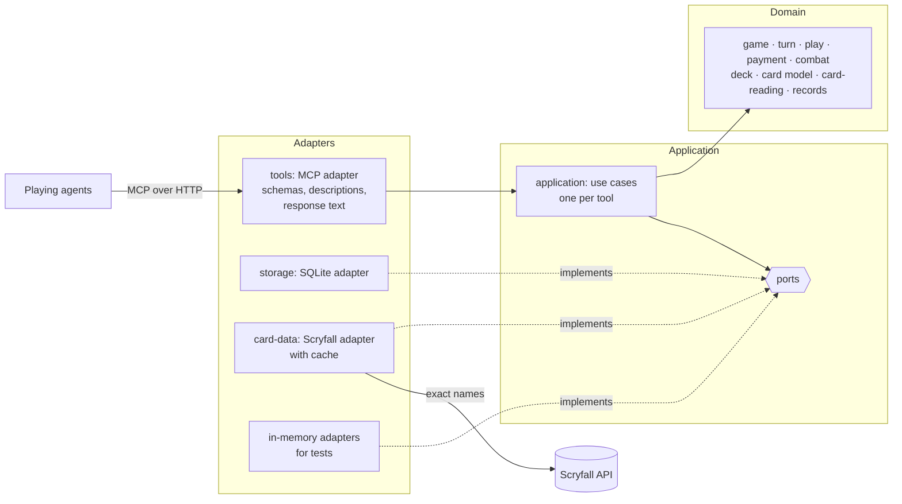

# High-Level Design: MTG Goldfishing

## Problem

A deck-building workflow has an AI agent write a Commander deck list and then play test games to find the deck's strengths and weaknesses. When those games are played entirely in the agent's head, three things go wrong:

- **Randomness is fake.** The agent effectively chooses its own draws, so opening hands, land drops and color problems reflect what the agent expects rather than a real shuffle.
- **State drifts.** Over a long game the agent loses track of tapped lands, hand size, commander tax, land drops and triggers. The errors compound silently, and they tend to compound in the deck's favor.
- **Results are unstructured.** Games cannot be reproduced, and findings live in prose rather than in data an analysis step can rely on.

A full rules engine would fix all three, but every card's behavior would have to be encoded, which is a multi-year undertaking. Most of the value comes from something much smaller.

## Approach

MTG Goldfishing is a service that **holds the game state, owns the randomness, does the bookkeeping that card data alone can support, and records everything**. The agent remains the player: it makes every decision and tells the service what each card does.

### The agent describes outcomes; the service fills in bookkeeping

A play is one call stating where things end up ("Cultivate: this Plains to the battlefield tapped, this Forest to hand"). The service applies it, pays the cost, moves the spell to its default destination, shuffles if the library was searched, and answers in a few lines ending with a one-line status of the game.

### Checks are advisory, structure is not

The service distinguishes two kinds of refusal. An **error** is a structural impossibility (a card that is not in the named zone, a game that has ended) and can never be overridden. A **rule check** is an approximation drawn from card data (cost not payable, land drop already used) and can always be overridden by the agent with a stated reason, which is recorded.

### The service reads card text where reading it is cheap and checkable

The service does not know what cards do, with deliberate exceptions: it reads rules text to learn **how much mana of which colors a permanent makes**, which **step triggers** a permanent has, whether a permanent has or grants **haste or vigilance**, has **flash**, and whether a permanent **enters tapped**. These are narrow, pattern-shaped readings whose results are shown to the agent, and they are what make automatic payment and trigger reminders possible.

### Everything is recorded

Every tool call is stored with its arguments, status and response, including refused ones (a log export is recorded by its size). Every accepted change is logged with the agent's choices and reasons, and each turn ends with a snapshot. Analysis happens outside the service, from these records.

### A domain model at the center

The game of Magic as this service sees it — games, card instances, zones, mana, costs, payments, steps, readings, deltas — is modelled directly in code, in the project's own vocabulary, with no knowledge of databases, networks or MCP. Everything else is arranged around that model as ports and adapters.

## Target Users

- **A playing agent**: an AI agent, usually a subagent, playing one goldfish game through the tools. It needs short calls, short answers that always say where the game stands, and refusals that explain themselves. It pays for every token in tool descriptions, calls and responses.
- **An orchestrating agent or person** running a deck-improvement workflow: loads a deck once, starts many games on it (often several at once, each played by its own subagent), then collects the logs.
- **An analysis process** that reads logs and snapshots as data and produces findings about the deck.
- **A maintainer**, human or agent, changing the service later. They need code that reads in the vocabulary of the game, rules that can be found in one place, and tests that say what behavior they protect.

## Goals

1. **The agent makes every decision a player would**: mulligans, land drops, what to cast and from where, every choice a card requires (X, modes, targets), attacks, blocks, and how each card resolves.
2. **The service owns state and randomness.** Shuffles are seeded, so the same loaded deck and seed reproduce the same game. Library order is never visible to the agent.
3. **The service does data-driven bookkeeping and checks**: mana payment (including X, additional costs and commander tax), zone integrity, land drops, hand size, and the full turn structure.
4. **Automatic payment preserves the agent's options.** When the agent does not say how to pay, the auto payment system pays in the way that leaves the most other plays available.
5. **Short exchanges.** A typical play is one short call with a two-to-four-line response. Full state is sent only on request.
6. **Concurrency.** Many agents run independent games at once without affecting each other.
7. **Drift detection.** Optional `expect` assertions and step trigger reminders catch the agent's picture of the game diverging from the real state.
8. **Complete records.** Logs, turn snapshots and call records give an outside process everything it needs, and survive a restart of the service.
9. **Usable on day one.** The service's own instructions and tool descriptions are enough for an agent to play a goldfish game, and a player brief makes it usable as a Claude Code subagent.
10. **Code that reads as the domain.** A rule of the game as the service sees it is written once, in the domain model, in glossary terms, and can be tested without a database, a network or an MCP client.

## Non-Goals

- **Implementing Magic's rules.** The service does not resolve abilities, apply replacement effects, track layers, manage the stack, or validate targets and modes.
- **Playing the game.** No built-in AI, heuristic policy or autopilot. The auto payment system chooses how to pay, never what to play.
- **Opponents.** Games are goldfish games against three imaginary opponents who take no actions. The agent may model an opponent's action itself as an effect.
- **Event-based triggers.** "Whenever a creature enters" and similar triggers are the agent's responsibility. Only step triggers get reminders.
- **Deck management.** No deck versions, deck history, or relationships between decks. A loaded deck is identified only by its contents.
- **Statistics and analysis.** The service stores and returns records. Metrics, comparisons and findings are produced elsewhere.
- **The deck-improvement workflow.** Building decks, analysing logs and editing decks happen outside the service.
- **Tuning the tool surface by measurement.** A loop that replays benchmark games to refine tool names, descriptions and response formats is a separate project; the call record exists so that project has data.
- **Ending games.** The service notifies when an end condition is met; only the agent ends a game.
- **Accounts, authentication and billing.** The service has no notion of who is calling.

## Tenets

Ordered: when two conflict, the higher one wins.

- **It's the agent's simulation.** When the service is unsure whether something is allowed, it lets the agent proceed with an override and records it, rather than blocking.
- **Best guess, shown.** When the service must read a card or choose on the agent's behalf, it acts on its best reading and says what it assumed; it holds back only when it has no usable reading at all.
- **Clear before cheap.** When a response or tool description could be shorter or clearer but not both, it is clearer.
- **The domain stays pure.** When a rule could live in the domain model or be handled more conveniently at the edge — in a tool handler, a query, a formatter — it lives in the domain model.
- **Build for local, don't block hosted.** Nothing is built for a multi-user hosted service until it is needed, but no choice may make one impossible.

## System Design

One long-running Python process serves MCP over streamable HTTP, mounted in a FastAPI application bound to the local machine. Agents connect by URL. All state lives in one SQLite database in WAL mode.

### Architecture: ports and adapters

The code is arranged in three rings, and dependencies point only inward.

- **Domain.** The model of a goldfish game and everything that can be decided from it: the `Game` aggregate with its card instances, zones and mana pool; the immutable `LoadedDeck`; value objects such as mana strings, costs, steps, deltas and readings; and domain services such as the auto payment system and the card reader. The domain performs no I/O, reads no clock, draws no randomness except through a seed it is given, and imports nothing from the other rings.
- **Application.** One use case per tool. A use case fetches what the domain needs through ports, asks the domain to decide, and saves the result. The application owns the ports: the interfaces through which it reaches persistence, card data, identifiers and time.
- **Adapters.** The MCP adapter drives the application: it turns tool calls into use-case requests and turns results into response text. The SQLite and Scryfall adapters are driven by it: they implement the ports. In-memory adapters implement the same ports for tests.

A use case returns a structured **outcome** — a status, a list of typed events (cost paid, cards drawn, reminder issued, notice raised), and the facts for the status line. Response text and log entries are both produced from that one outcome, so what the agent is told and what is recorded cannot disagree.

Domain operations never half-apply. An operation takes a game and returns either a changed game with its events or a refusal; a refused operation leaves the original untouched.

Every accepted change to a game increases that game's **change number**, which every response shows. A changing call may state the change number it follows; a call resent after a lost response is then recognised and answered with the original response instead of being applied twice.

Calls for the same game are applied one at a time; calls for different games do not wait on each other.

### Components

Each is one leaf design under `docs/intent/`, owning the requirement prefix shown.

| Component | Ring | Prefix | Owns |
|---|---|---|---|
| `game` | Domain | `GAME` | `new_game`, `mulligan`, `get_state`, `end_game`: the game aggregate, card instances, zones, name resolution, seeded shuffling, the change number, end-condition notices |
| `turn` | Domain | `TURN` | `advance`: the step sequence, automatic steps, trigger reminders, cleanup |
| `play` | Domain | `PLAY` | `play`, `effect`, `choose`: deltas, defaults, choices, pending choices, errors and rule checks, overrides, `expect` |
| `payment` | Domain | `PAY` | The mana pool, the auto payment system, agent-directed payment |
| `combat` | Domain | `CMBT` | `attack`: attackers, blocks, combat damage, commander damage |
| `deck` | Domain | `DECK` | `load_deck`: list parsing, commander, card definitions, deck checks, the content-derived deck id |
| `card-reading` | Domain | `READ` | Reading rules text and keywords: mana sources and their amounts, step triggers, haste and vigilance, flash, entering tapped |
| `records` | Domain | `REC` | `get_log`: the shape and meaning of log entries, turn snapshots and call records |
| `application` | Application | `APP` | The use cases, the ports, outcomes, transactions, per-game ordering, and the rule that dependencies point inward |
| `card-data` | Domain + adapter | `CARD` | The card model (domain) and the Scryfall adapter with its cache that supplies it |
| `storage` | Adapter | `STOR` | The SQLite adapter behind the persistence ports |
| `tools` | Adapter | `TOOL` | The MCP adapter: tool definitions and descriptions, the response text format and statuses, server instructions, the player brief, HTTP serving and configuration |

### Tools

`load_deck`, `new_game`, `mulligan`, `get_state`, `play`, `effect`, `attack`, `choose`, `advance`, `end_game`, `get_log`. Every game-scoped tool takes the game id first. All respond in compact text except `get_log`, which returns JSON.

### Testing

The rings are tested at their own level, so each test says one thing and fails for one reason.

- **Domain tests** (pytest) exercise the model directly, with no adapters at all. Game states are set up with test builders that read like the situation being tested.
- **Feature tests** (behave) express scenarios in the language of play and drive the service through its tools, with in-memory adapters behind the ports, so they run in milliseconds and never touch disk or network.
- **Contract tests** (pytest) state what each port promises and run against every adapter that implements it, in-memory and real alike, so the fakes used by other tests are known to behave like the real thing.
- **A small end-to-end check** starts the real process with SQLite and plays a short game over HTTP.
- **An architecture test** fails the build if an inner ring imports an outer one.

Tests use recorded card data and never reach the network. Every requirement is cited by at least one test.

## Key Design Decisions

- **A state keeper, not a rules engine.** The agent describes what cards do; the service checks only what card data supports. *Alternative:* a rules engine that resolves cards itself — rejected because encoding every card is years of work and the three problems above do not need it.
- **A domain model behind ports and adapters.** *Alternative:* tool handlers that read and write the database directly — rejected because the rules would be spread across handlers and SQL, could only be tested through a running server, and would be rewritten when the transport or database changes. *Alternative:* layers without explicit ports — rejected because nothing would stop game logic reaching for the database, and tests would need the real one.
- **One outcome, rendered twice.** A use case returns typed events; the response text and the log entry are both derived from them. *Alternative:* build the response string and the log entry separately — rejected because they drift apart.
- **Current state is stored; the log is a record.** *Alternative:* store only seed, deck and accepted calls, and rebuild state by replay — rejected because every later change to a check or to the auto payment system could change what an old game replays to, and play is forward-only. *Alternative:* state in memory with periodic saves — rejected because a restart could lose plays.
- **The service fetches card data from Scryfall itself, by exact name.** *Alternative:* have the agent look cards up and pass the data in — rejected because the data would cross the agent's context twice and any transcription error would silently corrupt every later payment check. *Alternative:* fetch through a card-lookup MCP server — rejected because the available one returns prose without faces, mana value or reliable name matching. The agent may still supply a **card definition** for any card in a deck, found or not, replacing the fetched data.
- **The service reads mana abilities from rules text.** Structured card data says which colors a card can make but not how much, and automatic payment needs both. *Alternative:* the agent declares every mana source — rejected as the largest source of bookkeeping the service exists to remove.
- **A resent call is harmless when the agent says what it follows.** *Alternative:* no protection — rejected because a call applied twice (a second draw, a second land) silently corrupts the game. *Alternative:* a client-chosen unique id per call — rejected because the change number is already on every response, costs nothing to produce, and also tells an agent when its picture of the game is stale.
- **The seed is visible to the playing agent.** Replaying a deck and seed is the purpose of a seed, and whoever starts the games chooses when to reuse one. A playing agent that has seen a seed's game before knows its draws; the service does not try to prevent that.
- **Decks are loaded once and referred to by id.** `load_deck` takes the list as text and returns an id derived from its contents and card data; `new_game` takes that id. *Alternative:* `new_game` takes a file path — rejected because server and agent may not share a disk. *Alternative:* `new_game` takes the list — rejected because a deck is normally played many times and the list would be resent each time.
- **Served over HTTP, not stdio.** One process serves every agent and is the shape a hosted service would take. *Alternative:* a stdio server launched per client — rejected because it cannot be offered to others later.
- **No identity.** Game ids are random and unguessable, which is the only access control. *Alternative:* users and sessions now — rejected under *Build for local, don't block hosted*.
- **The first turn draws a card by default.** A goldfish game stands in for a four-player game, where no player skips their first draw. `new_game` can turn this off.

## Success Metrics

- The same loaded deck and seed produce the same opening hand and the same draws, every time.
- An agent given only the server's instructions and tool descriptions completes a ten-turn goldfish game without reading any other documentation.
- In routine play, fewer than one call in ten is refused, and `get_state` is needed less than once per turn.
- After a game, the service's final state matches what an independent replay of the log entries produces by hand: no card is lost or duplicated between zones.
- Twenty games played at once produce twenty independent, complete logs.
- The whole domain and feature test suites run without a database file, a network connection or a running server.

**Falsification signals:** an agent can learn the order of its library other than by replaying a seed it has already played; a refused call changes state; a game's state is lost or altered by restarting the service; the auto payment system taps sources in a way that makes a card in hand uncastable when another payment would not have; a domain module imports an adapter; a rule of play is implemented in a tool handler or a SQL statement.

## References

- Scryfall API: `https://scryfall.com/docs/api`
- Model Context Protocol Python SDK: `https://github.com/modelcontextprotocol/python-sdk`
- Magic Comprehensive Rules 103.8c (no player skips the first draw in multiplayer), 903 (Commander)
- `GLOSSARY.md` for project vocabulary
